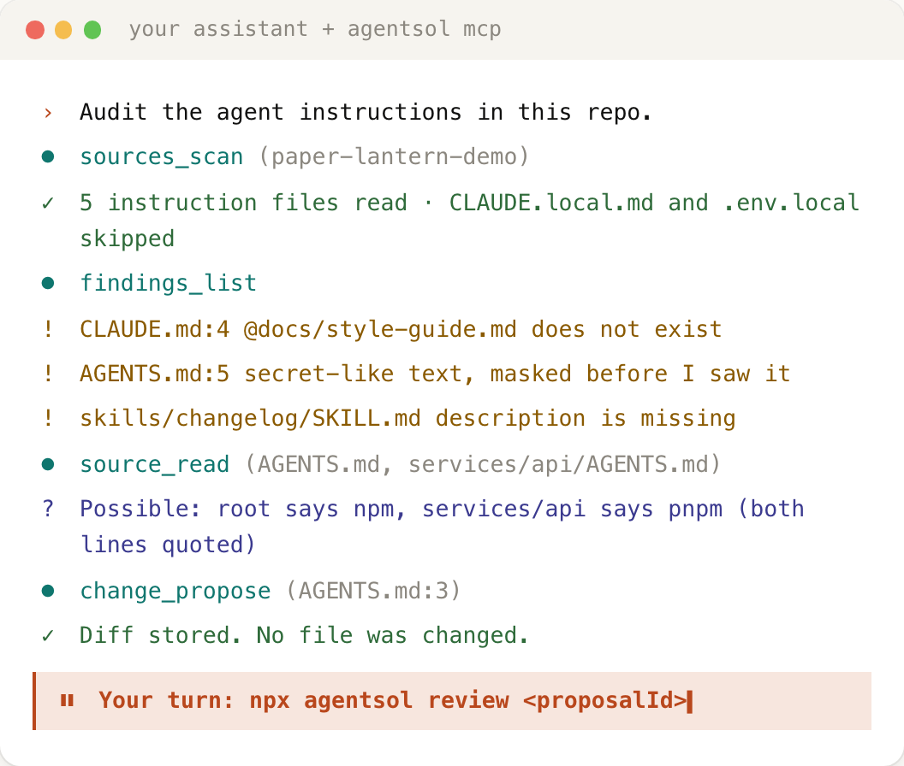
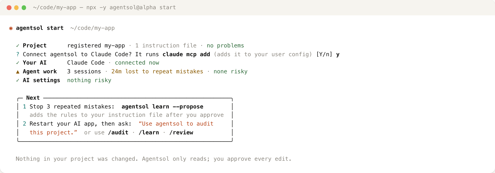
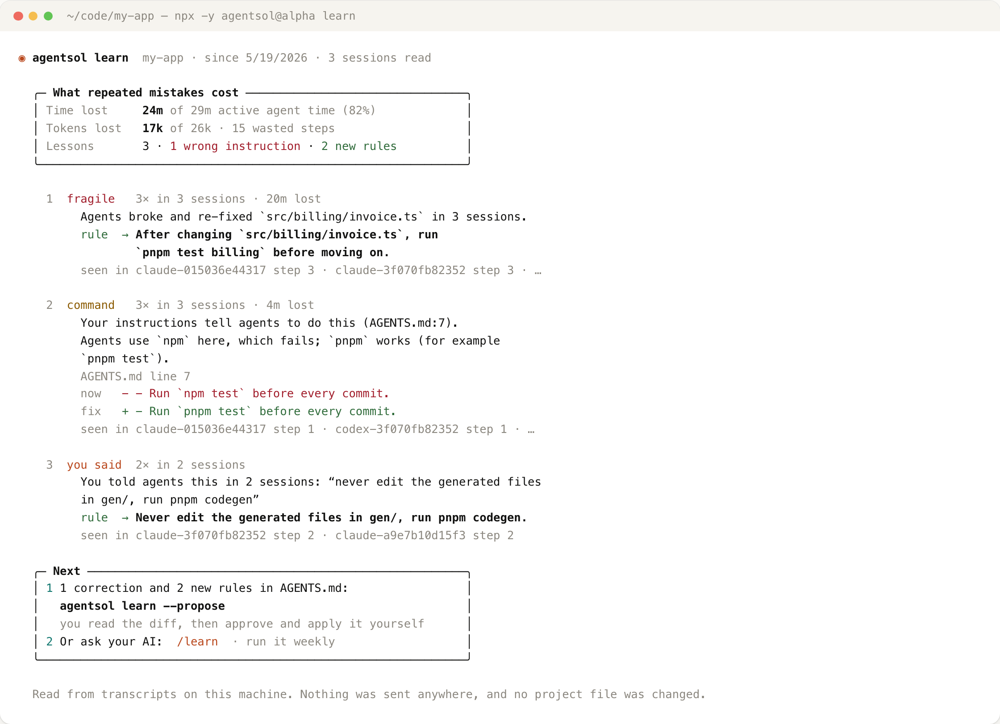
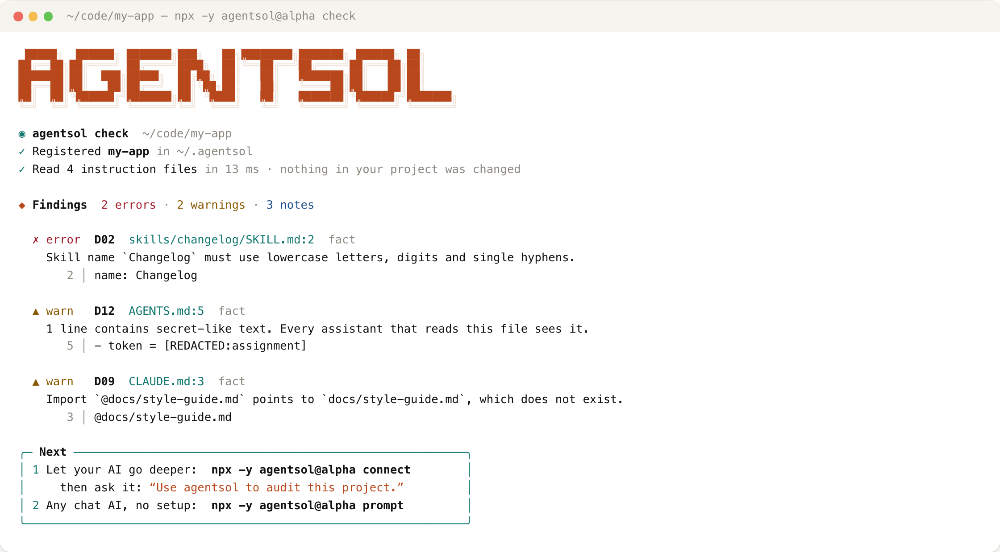
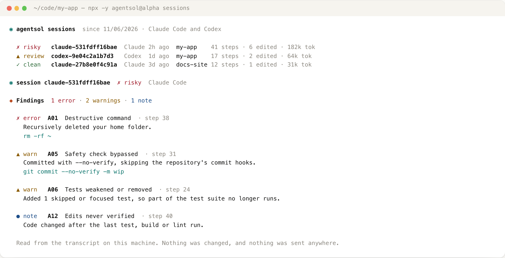
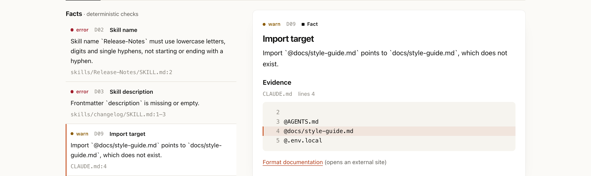
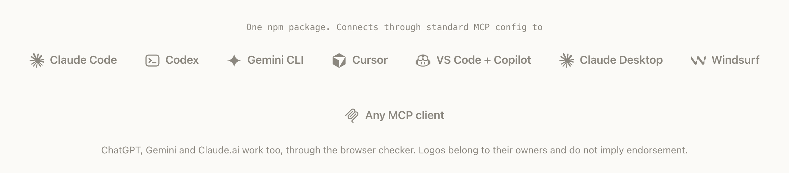
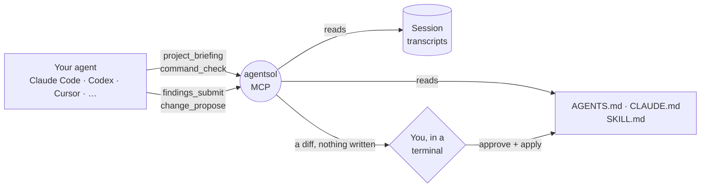

<p align="center">
  
</p>

<h1 align="center">Agentsol</h1>

<h3 align="center">Your AI agents do the work. Agentsol checks it.</h3>

<p align="center">
  An agent that reviews agent work: the <b>rules</b> your coding agents follow, <b>what they did</b> in each session,<br>
  and <b>how your AI apps are set up</b>. It runs on your machine, uses the assistant you already have, and every fix waits for you.
</p>

<p align="center">
  <a href="https://www.npmjs.com/package/agentsol"></a>
  
  
  
  
</p>

<p align="center">
  <a href="https://arsenic04.github.io/agentsol-site/">Website</a> ·
  <a href="https://arsenic04.github.io/agentsol-site/#/demo">Live demo</a> ·
  <a href="https://arsenic04.github.io/agentsol-site/#/check">Check in your browser</a> ·
  <a href="#quick-start">Quick start</a> ·
  <a href="#the-details">Docs</a>
</p>

<p align="center">
  
</p>

---

## Why

Agents forget everything between sessions. They run `npm` in a `pnpm` repo again, break the same file again, and you type the same correction again. Meanwhile the instruction files that should prevent this multiply quietly: a root `AGENTS.md`, a `CLAUDE.md` that imports it, a package folder with its own rules, skills whose frontmatter has to be just right. Nobody reads them side by side.

Agentsol reads all of it for you, from your own machine:

|  |  |
|---|---|
| **Learns from past sessions** | Finds the mistakes your agents keep repeating, what they cost in time and tokens, and the instruction line that caused them. |
| **Audits instruction files** | Drift between files, broken imports, invalid skills, secrets, unsafe or injected rules. Every finding cites a line. |
| **Reviews what agents did** | Destructive commands, skipped hooks, weakened tests, unverified edits, insecure code, in each Claude Code and Codex session. |
| **Checks your AI setup** | Keys in plain text, unpinned MCP servers, settings that let agents act without asking, across seven apps. |
| **Inspects before you install** | A verdict on any skill or MCP server: credential theft, data sent out, hidden instructions, tool poisoning. |

It never changes a file on its own. Your assistant can read and propose; only you can approve and apply, from a terminal you control.

## Quick start

```sh
cd your-project
npx -y agentsol@alpha start
```

One command: registers and scans this folder, connects the AI apps you have (it asks first), shows what past sessions cost, and what to fix first. Nothing is installed globally. No account, no API key, no hosted service.

<p align="center">
  
</p>

## What it does

### `learn` · your agent stops making the same mistake twice

Reads the Claude Code and Codex transcripts on your machine for this folder (last 180 days) and turns repeats into lessons: **commands** that fail here and the one that works, things **you said** in two or more sessions, **fragile** files agents break and re-fix, and commands that are **failing** everywhere. When your AGENTS.md or CLAUDE.md is the cause, it shows that line and its corrected version.

<p align="center">
  
</p>

```sh
npx -y agentsol@alpha learn              # what keeps going wrong, with the cost
npx -y agentsol@alpha learn --propose    # one diff per instruction file, for you to approve
```

Agents can use the lessons themselves: `project_briefing` gives an agent the rules for this folder when it starts, and `command_check` warns it before it runs a command that failed here before (`npm test` → `pnpm test`).

### `check` · a report you can act on

Reads only instruction files (AGENTS.md, AGENTS.override.md, CLAUDE.md, .claude/CLAUDE.md, SKILL.md), masks secret-like text before anything else sees it, and prints every finding with the exact line.

<p align="center">
  
</p>

### `sessions` · what did your agents actually do?

Flags risky steps in your recent agent sessions: destructive commands, secrets exposed to the model, skipped hooks, weakened tests, edits never verified, retry loops, prompt injection in tool output, and insecure code the agent added (14 checks, A01–A14). Your assistant can then grade a session on safety, instructions, verification, efficiency and scope.

<p align="center">
  
</p>

### `doctor` · is your AI setup safe?

Reads the settings of Claude Code, Claude Desktop, Codex, Cursor, VS Code, Windsurf and Gemini CLI: plaintext secrets in MCP config, unpinned or missing servers, shell-wrapped launches, settings that let assistants act without asking, hooks, and how many tokens your global instructions add to every session (10 checks, C01–C10). It only reads and never prints a secret value.

### `inspect` · is this skill or MCP server safe?

```sh
npx -y agentsol@alpha inspect ./some-skill        # a skill or server folder
npx -y agentsol@alpha inspect tools.json --json   # a server's tools/list result
```

A verdict (danger, caution, clean) with every finding's file and line. It exits 1 on danger, so it works as a CI gate. On 91 public skills from three plugin marketplaces it reported no false danger.

### In the browser

The [demo](https://arsenic04.github.io/agentsol-site/#/demo) shows real Agentsol output for a synthetic project: findings, cited evidence, the proposed diff and the load order.

<p align="center">
  
</p>

## Works with

<p align="center">
  
</p>

```sh
npx -y agentsol@alpha connect     # setup lines for each app
npx -y agentsol@alpha prompt      # no MCP? one masked prompt to paste into any chat AI
```

The MCP server is `npx -y -p agentsol@alpha agentsol-mcp`. In clients that support MCP prompts you get `/audit`, `/fix`, `/explain`, `/review`, `/setup` and `/learn`. Claude Desktop is not in the connector directory; add it through Settings → Developer → Edit Config (`connect claude-desktop` prints the config).

### As a skill

[`skills/agentsol/SKILL.md`](skills/agentsol/SKILL.md) tells your agent when to use Agentsol on its own: a briefing when it starts in a project, a check before build and test commands, lessons when a mistake repeats, and an inspect before installing anything. It uses the MCP tools when connected and falls back to `npx` otherwise. Copy the `skills/agentsol` folder into `.claude/skills/` in your project (or `~/.claude/skills/` for every project), or into your agent's skills folder.

## How it fits in your agent loop



1. **Before work:** the agent asks for a briefing and checks commands before running them.
2. **During review:** your assistant reads files through Agentsol, adds "possible" findings only by quoting exact lines, and proposes changes as diffs.
3. **The human step:** you review, approve with a one-time code and apply, in your own terminal. A backup is kept.

## What it will never do

- **Write without you.** There is no approve, apply, write or delete MCP tool. Approve, apply and reject refuse to run inside coding-agent terminals.
- **Send your data anywhere.** No hosted service, analytics or telemetry. What MCP tools return goes to your assistant's provider, as with any tool you use with it.
- **Show you a secret.** Secret-like text is masked before your assistant sees it (by pattern, so keep secrets out of instruction files anyway). Session and setup review return derived facts only, never transcript text or secret values.
- **Read what you did not register.** Only folders you add are visible. `CLAUDE.local.md`, `.env*`, keys, credentials, symlinks and hard-linked files are never read.

> **Early alpha (0.2.0-alpha.2).** A person has not yet run approve and apply end to end through this CLI; those steps are covered by automated tests only. No real assistant app has been formally validated. Tested on macOS (arm64) with Node 24 and 26; Linux and Windows are untested. Try it on the synthetic demo first and keep your files in version control.

## All commands

| Command | What it does |
|---|---|
| `start` | Register, scan, connect your apps, show session costs and what to fix first |
| `check` | Scan this folder: every finding with its line. `--strict` exits 1 on errors (CI), `--json` |
| `learn` | Lessons from past sessions. `--since 365d`, `--propose` |
| `sessions` · `session <id>` | What agents did, risky steps flagged. `--since 7d`, `--timeline` |
| `doctor` | Preflight plus the AI-app settings audit. `--strict` |
| `inspect <path>` | Verdict on a skill or MCP server |
| `connect` · `prompt` | Set up an app, or a paste-in prompt for chat AIs |
| `review` · `approve` · `apply` | The human step for a proposed change |

---

## The details

<details>
<summary><b>Learn, in depth</b></summary>

Agents forget between sessions, so they repeat the same mistakes in the same project. `learn` reads the Claude Code and Codex transcripts on your machine for sessions in this folder from the last 180 days and finds four kinds of lesson. A session started in a parent or sibling folder that worked here counts too, but only its steps in this folder, not what you said in it. A resumed session counts only from the start of the window, and a command lesson is dropped once that command later runs fine as written, so a rule the project outgrew is not kept. Claude Code deletes its transcripts after 30 days unless `cleanupPeriodDays` in its settings is higher, so older mistakes may be gone.

- **command**: a command that fails here and the one that works (`npm test` fails, `pnpm test` works).
- **you said**: something you told agents in two or more sessions ("no, use pnpm", "from now on…", "make sure you…", "I told you to…"), turned into a plain rule, masked and shortened. Text the app adds itself, like Codex's copy of AGENTS.md, is never counted as you.
- **fragile**: a file agents edit, break and re-edit before a check passes, in two or more sessions or three times in one, with the check that passed that tests this file (never a formatter or a test of another file).
- **failing**: a command that failed in several sessions and never worked anywhere; it asks you how to run it.

It also checks your instruction files against what happened. If AGENTS.md says "run `npm test`" and `npm` fails here, that line is why agents keep doing it: `learn` shows the file and line, the corrected line, and fixes it in place instead of adding a contradicting rule. It checks every AGENTS.md, AGENTS.override.md, CLAUDE.md and CLAUDE.local.md at any depth (in a monorepo, the wrong line in `packages/web/AGENTS.md` is corrected there, not with a second rule at the root), skips lines that already warn against the command, and only treats a bare word like `pytest` as a command in code or after "run". The same goes for things you told agents more than once: if you said "never edit the generated files in gen/, run pnpm codegen" in two sessions and AGENTS.md says "Edit the generated files in gen/ when the API changes", that line is replaced with what you said, instead of counting as already covered. This works for "never X", "don't X" and "use Y instead of X" or "Y, not X"; it leaves prose that only mentions X alone, and a line about a different scope ("in unit tests" against "in integration tests"). When a rule is written down but agents still break it, it says why: Codex reads AGENTS.md and not CLAUDE.md (and when a non-empty AGENTS.override.md sits next to AGENTS.md, Codex reads only the override, so rules go there), and Claude Code reads AGENTS.md only through an `@AGENTS.md` line in CLAUDE.md. With no instruction file yet, it names the one your apps read; when only Claude Code made the mistakes and CLAUDE.md does not import AGENTS.md, new rules go to CLAUDE.md. It works with symlinked project folders, Windows commands (`npm.cmd`, `$env:CI=1`) and CRLF instruction files, older and newer Codex transcript formats (including archived Codex sessions), Claude Code subagent transcripts (counted with the session that started them; a prompt one agent wrote for another is never read as something you said), `CODEX_HOME` and `CLAUDE_CONFIG_DIR` when set, and transcripts up to 512 MB.

```bash
npx -y agentsol@alpha learn                 # last 180 days
npx -y agentsol@alpha learn --since 365d
npx -y agentsol@alpha learn --propose       # one proposal per instruction file: corrections and new rules
npx agentsol review <proposalId>
```

Each lesson cites its session ids and step numbers, says whether the instruction file already covers it, and shows the active time and tokens it cost (pauses over 5 minutes count as 5 minutes). `--propose` never writes a file: you review, approve and apply each diff yourself, and running it again returns the proposals already waiting instead of new copies. Over MCP the same report is `lessons_list`, and `/learn` walks your assistant through it. Lessons are patterns, not proof; read each rule before keeping it.

When an agent starts work, `project_briefing` (pass the folder it works in; Claude Code, Codex and Gemini CLI start the server in the project, so there it can be left out) returns a short briefing: the rules to follow here, the instruction lines that are out of date with what to do instead, and the commands that never worked, which it should ask you about. Before a build, test, install or deploy command, `command_check` says whether that command failed here before and what worked instead (`npm test` → `pnpm test`), or that it never worked or goes against something you said, so the agent asks you first. Both are read-only, and the server tells connected agents to use them. To make sure every agent does, add one line to your AGENTS.md or CLAUDE.md: `Before you start, call the agentsol project_briefing tool with this folder and follow it.` When `learn --propose` adds a lessons section to a file, it includes a line like this for you.
</details>

<details>
<summary><b>Instruction checks, sessions and setup audit</b></summary>

- **Instructions.** Audits AGENTS.md, AGENTS.override.md, CLAUDE.md, .claude/CLAUDE.md and SKILL.md, including rules that tell assistants to do something unsafe (curl | sh, --no-verify, force-push, skipping failing tests, printing secrets), prompt-injection phrasing and invisible characters (D13–D15). The assistant reads and proposes changes through MCP. Only you can approve and apply a change, from a local CLI.
- **Sessions.** `agentsol sessions` reads the Claude Code and Codex transcripts on your machine and flags destructive commands, secrets exposed to the model, skipped hooks, weakened tests, edits never verified, retry loops, prompt injection in tool output, and insecure code the agent added such as SQL injection, disabled TLS checks or eval (A01–A14). Grades from your assistant are stored as assistant judgment next to the deterministic findings, never instead of them.
- **Setup.** `agentsol doctor` checks your AI apps' settings (C01–C10).
- `sessions --since 24h|7d|2w|<date> --limit N [path]` narrows the list; `--json` everywhere. `doctor --strict` exits 1 when the setup audit finds an error.
- `check` opens an interactive report: a banner, findings sorted by severity with the cited lines, and the next steps. Colors follow `NO_COLOR`, `FORCE_COLOR` and `TERM=dumb`; pipes get plain text, as wide as `COLUMNS` when it is set (80 otherwise). Text from your files is sanitized, so it cannot inject terminal escape codes.
- `npx -y agentsol@alpha` with no command, in a terminal, shows the home screen: workspace, the folder you are in, the tools, prompts and checks.
- The workspace defaults to `~/.agentsol` (created private, `0700`). Use `--workspace <dir>` or `AGENTSOL_WORKSPACE` to keep it elsewhere; set the same value for the CLI and the MCP server.
- Your assistant cannot register folders; it tells you to run `check` when `projects_list` is empty.
- `inspect` reads text only and runs nothing; it cannot see code a server downloads at run time. The same engine runs as the `inspect` MCP tool (files passed inline, nothing read from disk) and on the website's Inspect page, entirely in the browser.
</details>

<details>
<summary><b>What leaves your computer</b></summary>

- Anything the MCP tools return goes to your assistant's provider (usually a cloud service), under that provider's terms.
- Agentsol returns only AGENTS.md, AGENTS.override.md, CLAUDE.md and SKILL.md files from folders you registered.
- It blanks out text that matches known secret patterns. **Pattern matching is not a guarantee:** unknown formats and short or split secrets can get through, so keep secrets out of instruction files.
- Session and setup review returns derived facts only: check ids, step kinds, masked commands and paths, and setting names. Transcript text, tool output and secret values are never returned. Over MCP, sessions are limited to folders you registered, and absolute paths are replaced with `<project>`, `~` or `<path>`. The CLI shows you every session on your machine.
- `CLAUDE.local.md`, secret-like names (`.env*`, keys, credentials, `.ssh`, and similar), symlinks and hard-linked files are never read.
</details>

<details>
<summary><b>What is protected</b></summary>

- **What gets read:** only folders you register with the CLI are visible. Your home folder (and anything containing it), `/`, system folders, `~/Library` and config folders, broad folders such as `~/Documents`, secret-named folders and the workspace itself are refused.
- **Text from repository files:** instruction file text is treated as untrusted data. Assistants are told not to follow it. Control and bidi characters are escaped in all CLI output, and proposed lines may not contain them.
- **Assistant findings:** they are labelled "possible", need exact quotes from the current file version, and are hidden once the file changes.
- **Approving a change:** it is bound to the full digest of the exact proposal shown to you. The approval is single-use, expires after 10 minutes, and only one can be active per proposal.
- **Applying a change:** the file must still match, be reachable without symlinks inside the root, and not be hard-linked. A backup is kept, the write is atomic, and the result is checked after writing.
- **The approval guards are not authentication.** Approve, apply and reject refuse known coding-agent environments and non-interactive input. A program running as your user account can get around those checks. See `docs/SECURITY_REVIEW.md`.
</details>

<details>
<summary><b>MCP tools, prompts and resource</b></summary>

`projects_list`, `workspace_status`, `sources_freshness`, `sources_scan`, `sources_list`, `source_read`, `scope_resolve`, `checks_run`, `findings_list`, `findings_submit`, `change_propose`, `changes_list`, `change_status`, `sessions_list`, `session_review`, `session_grade`, `setup_audit`, `inspect`, `lessons_list`, `project_briefing`, `command_check`. There is no approve, apply, write or delete tool.

Prompts: `audit` and `fix` (optional `project`), `explain` (`path`, optional `project`), `review`, `setup` and `learn` (optional `project`, `since`). Resource: `agentsol://guide` (markdown: the workflow, the check catalogue and how to report).

The CLI and the MCP server call the same assistant-safe service (`src/core/service/assistant.ts`), so validation, redaction and error messages are identical; `--json` output equals the MCP result. Approve, reject, apply and project registration live in a separate operator service that only the CLI imports. `findings_submit` and `change_propose` accept an optional `requestKey`: retrying with the same key returns the original result, and reusing a key for a different request is refused.
</details>

<details>
<summary><b>Status and freshness</b></summary>

`status` / `workspace_status` keep three things separate:
- **Last-scan snapshot:** sources, findings (`findings.basis: "last_scan_snapshot"`) and proposal counts.
- **Coverage (`scan.partial`):** what the last scan could not inspect (skipped folders, depth limit, symlinks, case variants, secret-like names, files not read).
- **Freshness (observed now):** for each file the last scan recorded, a metadata-only `lstat` comparison (size, modification and change time, inode, device, link count). No content is read.
  - Per-file states are `metadata_unchanged`, `changed`, `removed`, `unsafe` (now a symlink, not a regular file, extra hard links, or outside the root) and `unknown`.
  - Project states are `no_known_changes`, `changes_detected` or `incomplete`; `unknown` when the root is missing, a symlink or replaced, or the scan predates freshness metadata; `not_checked` when the project was never scanned.

Matching metadata does **not** prove a file is unchanged, and new files are not detected until you scan again. Evidence checks and apply never use metadata; they compare byte hashes.
</details>

<details>
<summary><b>First run from source (synthetic data only)</b></summary>

Requirements: the installed package needs Node 24 or later. The source checkout needs Node with built-in TypeScript support and has only been run on Node 26.8.2. Run every step from this folder, in your own terminal.

1. **Install from the lockfile.** `npm ci` (exact versions from `package-lock.json`; nothing global).
2. **Preflight.** `npm run doctor`. It reports the Node version, whether the installed packages match the lockfile, whether this terminal is agent-driven (approve/apply refuse there), and with `-- --workspace <dir>` whether that folder is private. It reads only. `--json` for machine-readable output.
3. **Tests.** `npm run check` (typecheck plus all tests; fixtures are synthetic temp folders).
4. **Synthetic demo.** `npm run demo` creates `$TMPDIR/agentsol-demo` with a made-up project, drives the MCP server over stdio with the official SDK client (scan, read, a "possible" finding, one proposed edit), and prints the next commands. Run it again to see pending proposals; `-- --reset` recreates it (refuses while it holds proposals; add `--discard-proposals`); `-- --dir <empty folder>` puts it elsewhere.
5. **Check the workspace.** `npm run cli -- --workspace "$TMPDIR/agentsol-demo/workspace" status`.
6. **Review and decide, as a person.** `review <proposalId>`, then `approve <proposalId>` (type the one-time code), then `apply <proposalId>` (writes the demo file and keeps a backup).
7. **Optional: connect a client yourself.** `npm run doctor -- --workspace <ws>` prints an MCP stdio config with absolute paths. Agentsol never installs it.

```sh
npm run check                                       # typecheck plus all tests
export AGENTSOL_WORKSPACE="$PWD/.local-workspace"   # gitignored
npm run cli -- project add /path/to/a/project --name demo
npm run cli -- status                 # also: projects, sources, findings, scan, freshness <projectId>
npm run cli -- review <proposalId>
npm run cli -- approve <proposalId>   # interactive terminal; type the one-time code it shows
npm run cli -- apply <proposalId>     # interactive terminal; type "apply" (approvals expire after 10 minutes)
npm run cli -- reconcile <proposalId> # only if an apply was interrupted
npm run mcp                           # MCP server on stdio, same workspace
```

Example MCP client config (stdio). GUI clients often have a different `PATH`, so use the absolute `node` path that `npm run doctor -- --workspace <dir>` prints:
```json
{ "command": "/ABSOLUTE/PATH/TO/node", "args": ["/ABSOLUTE/PATH/TO/your-checkout/src/mcp/main.ts", "--workspace", "/ABSOLUTE/PATH/TO/your-checkout/.local-workspace"] }
```
</details>

<details>
<summary><b>Website and read-only workspace view</b></summary>

The site and the workspace view are one static app in `web/` (no framework, no runtime dependencies), built into `dist/web/`.

```sh
npm run web:build                                   # builds dist/web and records the synthetic demo data
npm run web:preview                                 # static site + demo at http://127.0.0.1:4318/ (no API)
npm run web:local -- --workspace "<workspace dir>"  # adds your workspace, read-only, at http://127.0.0.1:4317/
npm run test:web                                    # build, then browser tests (needs the local Playwright Chromium)
```

- **Demo** (`#/demo`) shows real Agentsol output recorded from the synthetic demo project at build time. The "possible" finding and the proposed change were prewritten by the demo script.
- **Workspace** (`#/workspace`) works only under `web:local`, which binds to 127.0.0.1, serves GET requests only, and cannot scan, edit, approve, apply or register folders. It opens only the workspace folder you name.
- The site loads nothing from other servers: no analytics, cookies, external fonts, CDNs or third-party scripts. A strict Content Security Policy blocks inline scripts.
- The local bridge (`src/web/`) must never be exposed to a network or run on a shared machine.
</details>

<details>
<summary><b>Release checks (maintainers)</b></summary>

- `npm run pack:check`: preview tarball in `artifacts/pack/` with a strict file allowlist; fails on install-time scripts, private paths, secret-like tokens or leftover `.ts` imports, and requires `"private": true`.
- `npm run install:check -- [--tarball <file>] [--node <path>]`: clean install into a temp folder with scripts disabled, then the CLI and an MCP stdio handshake against the installed copy only.
- `npm run release:check -- --node <node24>`: packs a staged copy without `"private"` into `artifacts/release/` (never overwriting a release file), runs the install check per Node runtime, then `npm publish --dry-run` on that exact file, confirms its sha512 did not change, and records everything in `<tarball>.release.json`.
- The repository's own `package.json` stays `"private": true`, so `npm publish` from this folder fails by design. Publishing is a person's step, with npm 2FA: `npm publish ./artifacts/release/agentsol-<version>.tgz --tag alpha --access public`.
- The package has no install scripts. It ships compiled JavaScript, this README and `LICENSE`, and depends on `@modelcontextprotocol/server`, `yaml` and `zod`.
</details>

<details>
<summary><b>Known limitations</b></summary>

- If a different folder appears at a registered path (deleted and recreated, or swapped), scans and apply refuse with `root_replaced` until you confirm it yourself with `project add <the same path>`.
- Load figures from `npm run load:test` (synthetic monorepos up to about 5,000 files) describe one Mac and are not a guarantee; see `docs/ALPHA_VERIFICATION.md`.
- The website has not been tested with a screen reader and has had no formal accessibility audit.
- Backups in `<workspace>/backups` keep original bytes, secrets included. The workspace must be private (`chmod 700`).
- `scope_resolve` models documented defaults for a given working directory and always reports `coverage: "partial"`.
- Freshness is metadata-only and only covers files recorded by the last scan; it cannot prove that nothing changed.
- Claude Code scope assumes the default "Project instructions" setting. User-level, managed and `.claude/rules` files are not inspected. Cursor `.mdc` rules are not supported.
- Only LF or CRLF files with consistent line endings can be edited. Lines with redacted secrets cannot be edited through Agentsol.
- A process that can rewrite folders inside the project during an apply can still race the final rename. This is detected afterwards (`write_unverified`) but not prevented. Power loss during apply is not tested.
- Tested on macOS only; Linux and Windows are untested.
</details>

<details>
<summary><b>Version history and earlier names</b></summary>

- `0.1.0-alpha.2` added `check`, `connect`, `prompt`, the default workspace and the MCP prompts. Session review, grading and the setup audit arrived with `0.2.0-alpha.0`; `learn` with `0.2.0-alpha.1`; `start` with `0.2.0-alpha.2`.
- Earlier names were AgentWeave, then Agentlore (both Nov 2026; the npm name `agentlore` was refused as too similar to an existing package). `AGENTLORE_WORKSPACE`, then `AGENTWEAVE_WORKSPACE`, still work when `AGENTSOL_WORKSPACE` is not set. Existing workspaces need no migration.
- Demos made earlier in `$TMPDIR/agentweave-demo` or `$TMPDIR/agentlore-demo` still work with `--workspace "$TMPDIR/agentweave-demo/workspace"`.
</details>

---

<p align="center"><sub>MIT licence · made for people who let agents write code and want to know what they did · logos belong to their owners and do not imply endorsement</sub></p>
